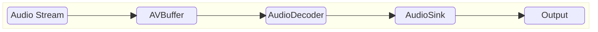
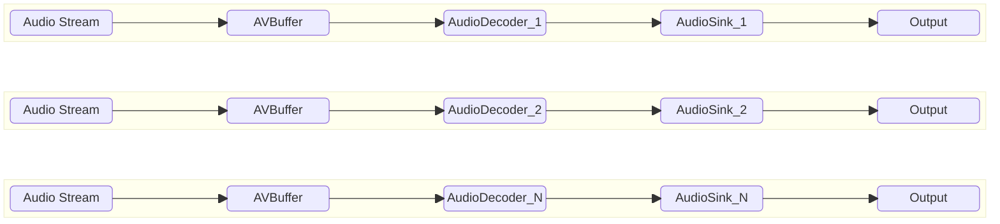

# Audio Sink High Level Test Specification Document

## Table of Contents

- [Acronyms, Terms and Abbreviations](#acronyms-terms-and-abbreviations)
- [Introduction](#introduction)
- [Module Description](#module-description)
- [L2 Test Specification](#l2-test-specification)
- [L3 Test Specification](#l3-test-specification)

## Acronyms, Terms and Abbreviations

- `HAL`    - Hardware Abstraction Layer
- `API`    - Application Programming Interface
- `AIDL`   - Android Interface Definition Language
- `L2`     - Level 2 Testing
- `L3`     - Level 3 Testing
- `NA`     - Not Applicable
- `Caller` - Any user of the interface via the `APIs`
- `CB`     - Call-back function (suffix)
- `PCM`    - Pulse Code Modulation
- `AC3`    - Audio Codec 3
- `EAC3`   - Enhanced `AC3`
- `WMA`    - Windows Media Audio
- `AAC`    - Advanced Audio coding
- `DD`     - DOLBY Digital
- `DDPLUS` - DOLBY Digital Plus
- `RDK`    - Reference Design Kit
- `EOS`    - End of Stream
- `PTS`    - Presentation Time Stamp
- `rms`    - Root Mean Square

## Introduction

This document provides an overview of the testing requirements for the Audio Sink module. It outlines the scope of testing, objectives, testing levels and approaches, specific test requirements, and expected deliverables.

- Audio Sink Interface Definitions - [Audio Sink HAL](https://github.com/rdkcentral/rdk-halif-aidl/tree/v0.6/audiosink/current/com/rdk/hal/audiosink)

- Audio Sink Overview - [Audio Sink Overview](https://wiki.rdkcentral.com/display/RDKHAL/Audio+Sink)

## Module Description

The Audio sink `HAL` provides an interface to sink non-tunnelled `PCM` audio frame buffers to the audio mixer and provide app level controls for mixing levels and fade controls.

The Audio Sink HAL cannot handle audio frame buffers when tunnelled audio is exclusively in use or when audio passthrough mode is enabled.

The `RDK` middleware GStreamer pipeline contains an `RDK` Audio Sink element designed specifically to work with the Audio Sink HALinterface.

Audio Sink HAL interface takes decoded Audio frame buffers.

## Test Streams Specification

- List of audio test streams: [Audio TestStreams](audioSink_TestStreams.md)

- Each Test should refer [vts_l3_test_config.yaml](../../test_configuration/vts_l3_test_config.yaml) for the streams and information like `PTS`, frame sizes for the test.

## L2 Test Specification

|Test|Description|HAL APIs|
|----|-----------|--------|
|Set and Get Audio Sink Properties|<ul><li>Read supported audio sinks using `IAudioSinkManager` class</li><li>Loop through supported audio sinks</li><li>set read-write properties (`Property`) of sinks and verify using get function</li></ul>|<ul><li>IAudioSinkManager - getAudioSinkIds, getAudioSink</li><li>IAudioSink - open, getProperty, setProperty, close </li></ul>|
|States of Audio Sink|<ul><li>Read supported audio sinks using `IAudioSinkManager` class</li><li>Loop through supported audio sinks</li><li>Register event listeners using `registerEventListener`</li><li>Ensure state transitions (`open`->`start`->`flush`->`stop`->`close`) audio sink and verify the state using</li><li>`getState`. Validate event listener notifications using `onStateChanged`</li></ul>|<ul><li>IAudioSinkManager - getAudioSinkIds, getAudioSink</li><li>IAudioSink - open, registerEventListener, unregisterEventListener, close </li><li>IAudioSinkController - start, stop</li></ul>|
|Set and Get Audio Sink Volume|<ul><li>Read supported audio sinks using `IAudioSinkManager` class</li><li>Loop through supported audio sinks</li><li>Register event listeners using `registerEventListener`</li><li>`open` audio sink and verify the state using `getState` state should be in `READY`</li><li>set volume ranging from 0.0, to 1.0 by increasing 0.1 on each iteration on opened sink using `setVolume` and verify using `getVolume` set and get volume should be equal</li> <li>After verification `close` the sink check state should be in `CLOSED`</li><li>Unregister event listeners using `unregisterEventListener`</li></ul>|<ul><li>IAudioSinkManager - getAudioSinkIds, getAudioSink</li><li>IAudioSink - registerEventListener, open, getState, unregisterEventListener, close </li><li>IAudioSinkController - start, setVolume, getVolume, stop</li></ul>|
|Mute And UnMute Audio Sink Volume|<ul><li>Read supported audio sinks using `IAudioSinkManager` class</li><li>Loop through supported audio sinks</li><li>Register event listeners using `registerEventListener`</li><li>`open` audio sink and verify the state using `getState` state should be in `READY`</li><li>set volume ranging from 0.1 to 1.0 by increasing 0.1 on each iteration set mute on sinks using `setVolume`, verify mute status using `getVolume` and set unmute `setVolume`, verify the mute status, volume using `getVolume`</li><li>After verification `close` the sink check state should be in `CLOSED`</li><li>Unregister event listeners using `unregisterEventListener`</li></ul>|<ul><li>IAudioSinkManager - getAudioSinkIds, getAudioSink</li><li>IAudioSink - registerEventListener, open, getState, unregisterEventListener, close </li><li>IAudioSinkController - start, setVolume, getVolume, stop</li></ul>|
|Set Audio Sink VolumeRamp|<ul><li>Read supported audio sinks using `IAudioSinkManager` class</li><li>Loop through supported audio sinks</li><li>Register event listeners using `registerEventListener`</li><li>`open` audio sink and verify the state using `getState` state should be in `READY`</li><li>`start` opened audio sink verify the state using `getState` and sink state should be in `STARTED`</li><li>set volumeRamp on sinks using `setVolumeRamp` loop through `getVolume` until volume is set to same as target volume</li>After verification `stop` check state should be in `READY`, and `close` the sink check state should be in `CLOSED`</li><li>Unregister event listeners using `unregisterEventListener`</li></ul>|<ul><li>IAudioSinkManager - getAudioSinkIds, getAudioSink</li><li>IAudioSink - open, registerEventListener, getState, unregisterEventListener, close</li><li>IAudioSinkController - start, setVolumeRamp,, getVolume, stop</li></ul>|
|Set Audio Sink VolumeRamp In Mute |<ul><li>Read supported audio sinks using `IAudioSinkManager` class</li><li>Loop through supported audio sinks</li><li>Register event listeners using `registerEventListener`</li><li>`open` audio sink and verify the state using `getState` state should be in `READY`</li><li>`start` opened audio sink verify the state using `getState` and sink state should be in `STARTED`</li><li>set volume to mute using `setVolume` set volumeRamp on sinks using `setVolumeRamp`,verify volume by looping through `getVolume` until volume is same as target volume and  mute status should be in umute</li>After verification `stop` check state should be in `READY`, and `close` the sink check state should be in `CLOSED`</li><li>Unregister event listeners using `unregisterEventListener`</li></ul>|<ul><li>IAudioSinkManager - getAudioSinkIds, getAudioSink</li><li>IAudioSink - open, registerEventListener, getState, unregisterEventListener, close</li><li>IAudioSinkController - start, setVolume, setVolumeRamp, getVolume, stop</li></ul>|
|ReSet Audio Sink VolumeRamp|<ul><li>Read supported audio sinks using `IAudioSinkManager` class</li><li>Loop through supported audio sinks</li><li>Register event listeners using `registerEventListener`</li><li>`open` audio sink and verify the state using `getState` state should be in `READY`</li><li>`start` opened audio sink verify the state using `getState` and sink state should be in `STARTED`</li><li>set volumeRamp on sink using `setVolumeRamp` immediately call set volumeRamp again on sink using `setVolumeRamp`, verify the volume by looping `getVolume` until volume is same as set target volume</li>After verification `stop` check state should be in `READY`, and `close` the sink check state should be in `CLOSED`</li><li>Unregister event listeners using `unregisterEventListener`</li></ul>|<ul><li>IAudioSinkManager - getAudioSinkIds, getAudioSink</li><li>IAudioSink - open, registerEventListener, getState, unregisterEventListener, close</li><li>IAudioSinkController - start, getVolume, setVolumeRamp, stop</li></ul>|
|Call Stop Audio Sink while VolumeRamp In Progress|<ul><li>Read supported audio sinks using `IAudioSinkManager` class</li><li>Loop through supported audio sinks</li><li>Register event listeners using `registerEventListener`</li><li>`open` audio sink and verify the state using `getState` state should be in `READY`</li><li>`start` opened audio sink verify the state using `getState` and sink state should be in `STARTED`<li>set volumeRamp on sink using `setVolumeRamp` immediately call `stop` audio sink and verify volume is set to target volume using `getVolume` </li><li>After verification `stop` check state should be in `READY`, and `close` the sink check state should be in `CLOSED`</li><li>Unregister event listeners using `unregisterEventListener`</li></ul>|<ul><li>IAudioSinkManager - getAudioSinkIds, getAudioSink</li><li>IAudioSink - open, getState, registerEventListener, unregisterEventListener, close</li><li>IAudioSinkController - start, setVolumeRamp, getVolume, stop</li></ul>|

## L3 Test Specification

### Prerequisites

#### AV Buffer

Audio frames are supplied to the Audio Sink during testing, which necessitates a pre-validated AVBuffer module. Therefore, the AVBuffer must successfully pass VTS L1, L2, and L3 testing before being used in the Audio Decoder tests

### Feature List

VTS L3 validates all the Audio Sink features in both sequential and concurrent sink modes (if the platform supports multiple sinks) as represented below.

#### Sequential Sink

The Sequential Sink test evaluates each audio sink individually, one after another, to ensure functional correctness across all supported features. This approach helps isolate issues and verify that every sink instance performs as expected in a standalone environment.

#### Concurrent Sink

The Concurrent Sink test assesses the system's ability to handle multiple audio sinks operating simultaneously, each configured with different supported features. This test is designed to validate the robustness, resource management, and feature compatibility of the platform under concurrent load, and is applicable only if the platform supports multiple sink instances.

The following table outlines the core features validated in the L3 test phase

|#|Testing Feature|Description|
|-|---------------|-----------|
|1|Audio Decoder Tunnel/Non-Tunnel|Executes the decoder in tunnel mode. Based on stream format, the decoder chooses between tunnel and non-tunnel operation. In tunnel mode, the test validates only metrics and metadata. In non-tunnel mode, test also validates decoded buffers by comparing their `rms` difference against reference data.|
|2|Audio Sink Tunnel/Non-Tunnel| In tunnel mode or passthrough, sink cannot handle the audio frames.In non-tunnel mode sink receives PCM data and checks functionality of the sink| 
|3|Secure and Non-Secure|Initializes the sink in secure mode, ensuring all buffer operations occur in secure memory|
|4|Underflow|Verifies sink behaviour audio underflow . Ensures appropriate events are raised|
|5|First Frame Rendered|Verifies sink behaviour audio first frame rendered when ever first frame received . Ensures appropriate events are raised|
|6|Latency|Verifies sink behaviour latency when ever the frame rendered . Ensures property metric captured|
|7|Resumed|Verifies sink behaviour audio resumed. Ensures appropriate events are raised|
|8|EOS|Test the sink's handling of an `eos` (end-of-stream) signal. The sink should correctly sink all frames up to `eos` ensure appropriate events raised. It must ignore any buffers received after `eos`|
|9|Queue Depth|This test  checks Queue depth and it should not accept any audio frames after `eos` or buffer full passed to it and read the values from the property metrics|
|10|Error Streams|Verifies sink behaviour with error streams. Ensures appropriate events are raised and frame metadata is updated accurately|
|11|Flush Complete|Verifies sink behaviour flush complete . Ensures appropriate events are raised|
|12|Flush|Verifies sink behaviour flush. Ensures appropriate events are raised|
|13|Concurrent sink|If platform supports multiple sinks, test executes multiple sinks simultaneously, validating callbacks and their respective metrics.|

### Test Cases

The table below summarizes the L3 test cases executed using various audio stream formats and configurations. These tests are also executed in a multi-process environment:

|#|Test|Decoder Tunnel|Secure|Underflow|FirstFrame|Latency|Resumed|EOS|QueueDepth|Error|Flush|Concurrency|
|-|----|--------------|------|---------|----------|-------|-------|---|----------|-----|-----|-----------|
|1|Decode_Sink_Sequential_NonTunnel_NonSecure_Underflow|✘|✘|✔|✘|✘|✘|✘|✘|✘|✘|✘|
|2|Decode_Sink_Sequential_NonTunnel_NonSecure_FirstFrame|✘|✘|✘|✔|✘|✘|✘|✘|✘|✘|✘|
|3|Decode_Sink_Sequential_NonTunnel_NonSecure_Latency|✘|✘|✘|✘|✔|✘|✘|✘|✘|✘|✘|
|4|Decode_Sink_Sequential_NonTunnel_NonSecure_Resumed|✘|✘|✘|✘|✘|✔|✘|✘|✘|✘|✘|
|5|Decode_Sink_Sequential_NonTunnel_NonSecure_EOS|✘|✘|✘|✘|✘|✘|✔|✘|✘|✘|✘|
|6|Decode_Sink_Sequential_NonTunnel_NonSecure_QueueDepth|✘|✘|✘|✘|✘|✘|✘|✔|✘|✘|✘|
|7|Decode_Sink_Sequential_NonTunnel_NonSecure_Error|✘|✘|✘|✘|✘|✘|✘|✘|✘|✔|✘|✘|
|8|Decode_Sink_Sequential_NonTunnel_NonSecure_Flush|✘|✘|✘|✘|✘|✘|✘|✘|✘|✘|✔|✘|
|9|Decode_Sink_Sequential_NonTunnel_Secure_Underflow|✘|✔|✔|✘|✘|✘|✘|✘|✘|✘|✘|
|10|Decode_Sink_Sequential_NonTunnel_Secure_FirstFrame|✘|✔|✘|✔|✘|✘|✘|✘|✘|✘|✘|
|11|Decode_Sink_Sequential_NonTunnel_Secure_Latency|✘|✔|✘|✘|✔|✘|✘|✘|✘|✘|✘|
|12|Decode_Sink_Sequential_NonTunnel_Secure_Resumed|✘|✔|✘|✘|✘|✔|✘|✘|✘|✘|✘|
|13|Decode_Sink_Sequential_NonTunnel_Secure_EOS|✘|✔|✘|✘|✘|✘|✔|✘|✘|✘|✘|
|14|Decode_Sink_Sequential_NonTunnel_Secure_QueueDepth|✘|✔|✘|✘|✘|✘|✘|✔|✘|✘|✘|
|15|Decode_Sink_Sequential_NonTunnel_Secure_Error|✘|✔|✘|✘|✘|✘|✘|✘|✔|✘|✘|
|16|Decode_Sink_Sequential_NonTunnel_Secure_Flush|✘|✔|✘|✘|✘|✘|✘|✘|✘|✘|✔|✘|
|17|Decode_Sink_Sequential_Tunnel_NonSecure_FirstFrame|✔|✘|✘|✔|✘|✘|✘|✘|✘|✘|✘|
|18|Decode_Sink_Sequential_Tunnel_NonSecure_EOS|✔|✘|✘|✘|✘|✘|✔|✘|✘|✘|✘|
|19|Decode_Sink_Sequential_Tunnel_NonSecure_Error|✔|✘|✘|✘|✘|✘|✘|✘|✘|✔|✘|✘|
|20|Decode_Sink_Sequential_Tunnel_Secure_FirstFrame|✔|✔|✘|✔|✘|✘|✘|✘|✘|✘|✘|
|21|Decode_Sink_Sequential_Tunnel_Secure_EOS|✔|✔|✘|✘|✘|✘|✔|✘|✘|✘|✘|
|22|Decode_Sink_Sequential_Tunnel_Secure_Error|✔|✔|✘|✘|✘|✘|✘|✘|✘|✔|✘|✘|
|23|Decode_Sink_Concurrent_NonTunnel_NonSecure_Underflow|✘|✘|✔|✘|✘|✘|✘|✘|✘|✘|✔|
|24|Decode_Sink_Concurrent_NonTunnel_NonSecure_FirstFrame|✘|✘|✘|✔|✘|✘|✘|✘|✘|✘|✔|
|25|Decode_Sink_Concurrent_NonTunnel_NonSecure_Latency|✘|✘|✘|✘|✔|✘|✘|✘|✘|✘|✔|
|26|Decode_Sink_Concurrent_NonTunnel_NonSecure_Resumed|✘|✘|✘|✘|✘|✔|✘|✘|✘|✘|✔|
|27|Decode_Sink_Concurrent_NonTunnel_NonSecure_EOS|✘|✘|✘|✘|✘|✘|✔|✘|✘|✘|✔|
|28|Decode_Sink_Concurrent_NonTunnel_NonSecure_QueueDepth|✘|✘|✘|✘|✘|✘|✘|✔|✘|✘|✔|
|29|Decode_Sink_Concurrent_NonTunnel_NonSecure_Error|✘|✘|✘|✘|✘|✘|✘|✘|✘|✔|✘|✔|
|30|Decode_Sink_Concurrent_NonTunnel_NonSecure_Flush|✘|✘|✘|✘|✘|✘|✘|✘|✘|✘|✔|✔|
|31|Decode_Sink_Concurrent_NonTunnel_Secure_Underflow|✘|✔|✔|✘|✘|✘|✘|✘|✘|✘|✔|
|32|Decode_Sink_Concurrent_NonTunnel_Secure_FirstFrame|✘|✔|✘|✔|✘|✘|✘|✘|✘|✘|✔|
|33|Decode_Sink_Concurrent_NonTunnel_Secure_Latency|✘|✔|✘|✘|✔|✘|✘|✘|✘|✘|✔|
|34|Decode_Sink_Concurrent_NonTunnel_Secure_Resumed|✘|✔|✘|✘|✘|✔|✘|✘|✘|✘|✔|
|35|Decode_Sink_Concurrent_NonTunnel_Secure_EOS|✘|✔|✘|✘|✘|✘|✔|✘|✘|✘|✔|
|36|Decode_Sink_Concurrent_NonTunnel_Secure_QueueDepth|✘|✔|✘|✘|✘|✘|✘|✔|✘|✘|✔|
|37|Decode_Sink_Concurrent_NonTunnel_Secure_Error|✘|✔|✘|✘|✘|✘|✘|✘|✘|✔|✘|✔|
|38|Decode_Sink_Concurrent_NonTunnel_Secure_Flush|✘|✔|✘|✘|✘|✘|✘|✘|✘|✘|✔|✔|
|39|Decode_Sink_Concurrent_Tunnel_NonSecure_FirstFrame|✔|✘|✘|✔|✘|✘|✘|✘|✘|✘|✔|
|40|Decode_Sink_Concurrent_Tunnel_NonSecure_EOS|✔|✘|✘|✘|✘|✘|✔|✘|✘|✘|✔|
|41|Decode_Sink_Concurrent_Tunnel_NonSecure_Error|✔|✘|✘|✘|✘|✘|✘|✘|✘|✔|✘|✔|
|42|Decode_Sink_Concurrent_Tunnel_Secure_FirstFrame|✔|✔|✘|✔|✘|✘|✘|✘|✘|✘|✔|
|43|Decode_Sink_Concurrent_Tunnel_Secure_EOS|✔|✔|✘|✘|✘|✘|✔|✘|✘|✘|✔|
|44|Decode_Sink_Concurrent_Tunnel_Secure_Error|✔|✔|✘|✘|✘|✘|✘|✘|✘|✔|✘|✔|