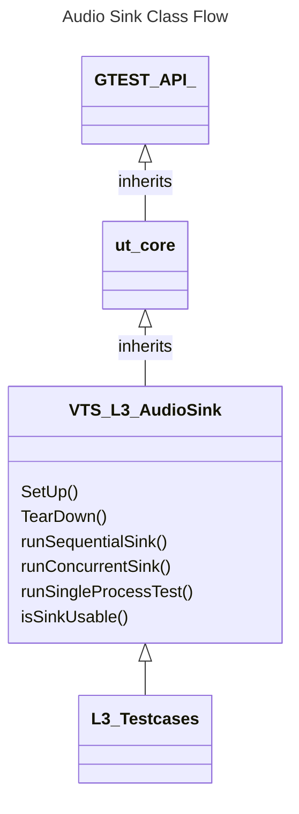
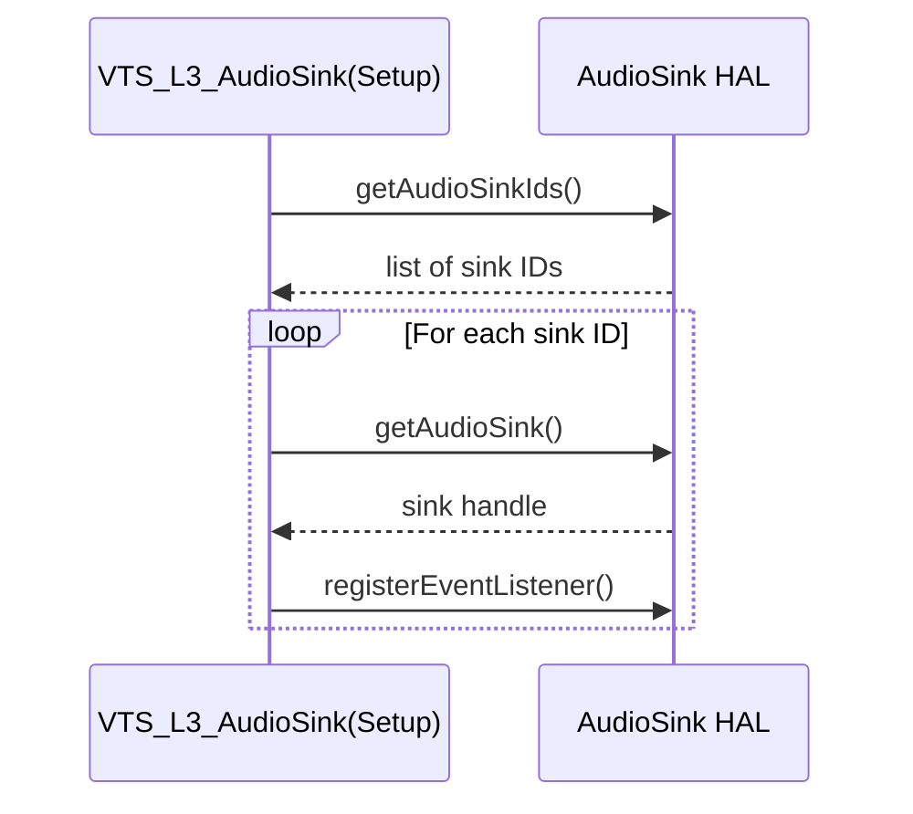
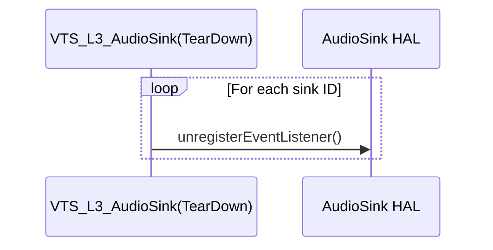
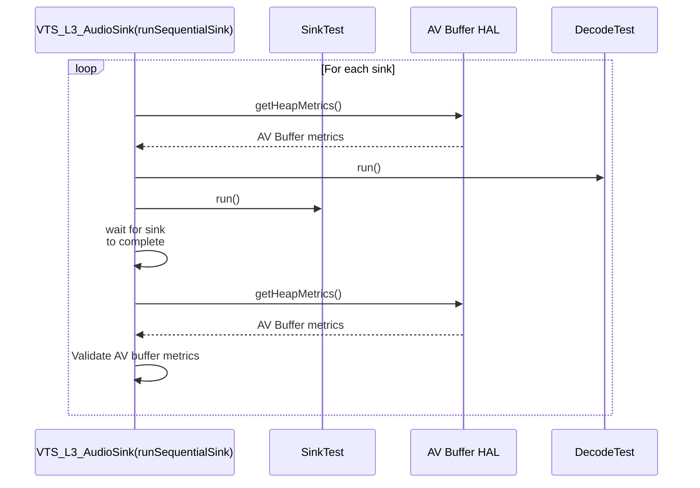
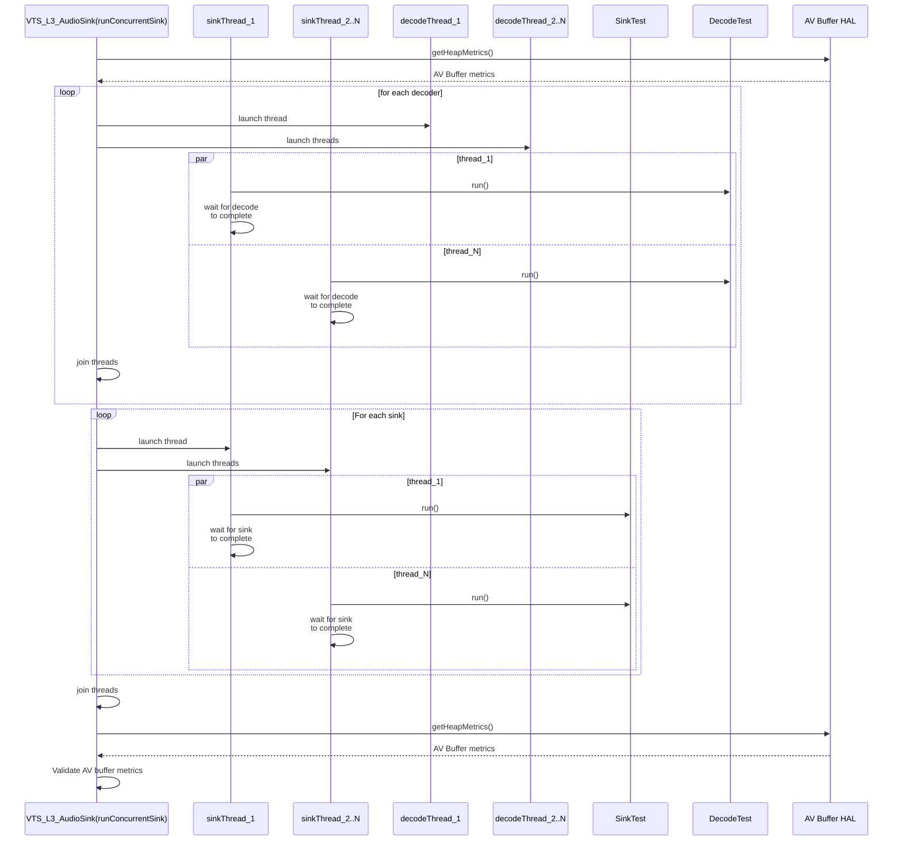
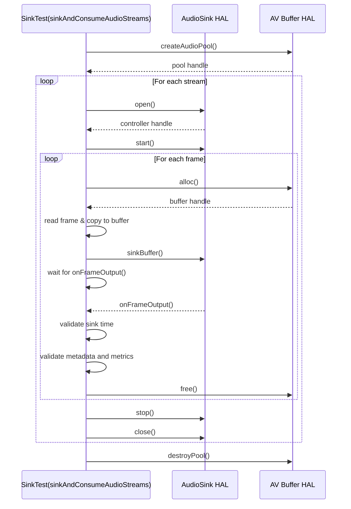
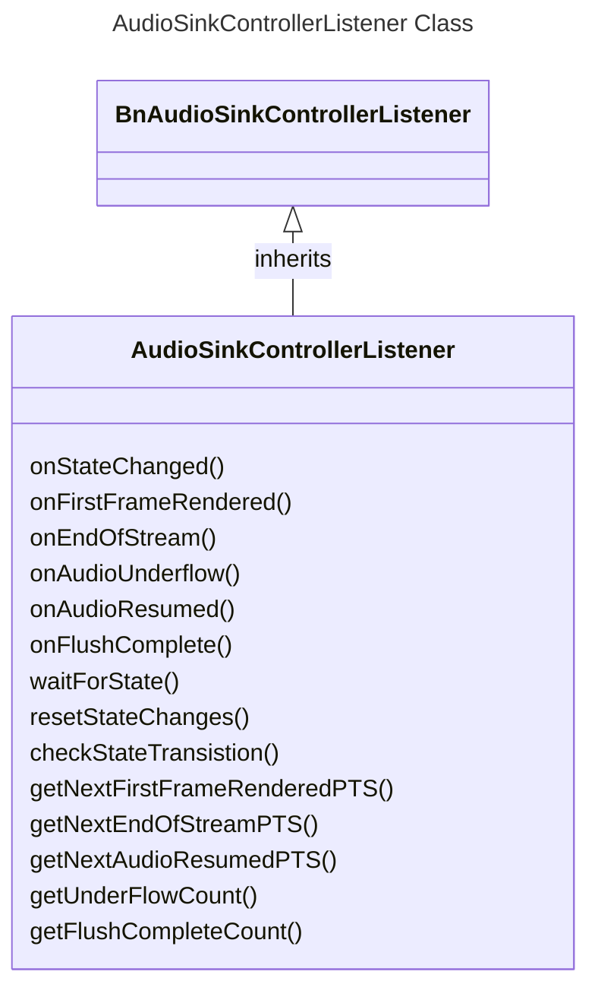
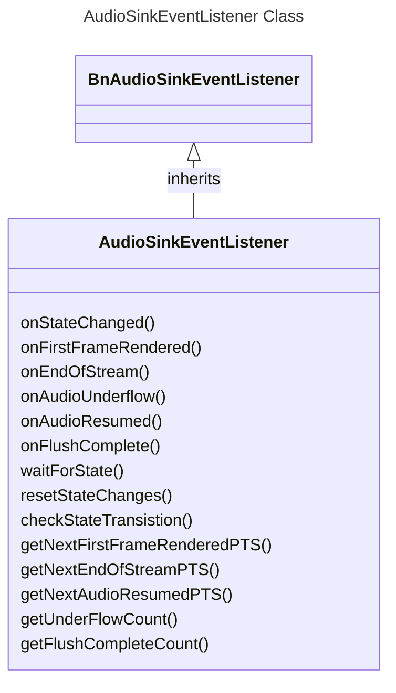

# AUDIO DECODER L3 Low Level Test Specification and Procedure Documentation

## Table of Contents

- [Overview](#overview)
- [Acronyms, Terms and Abbreviations](#acronyms-terms-and-abbreviations)
- [References](#references)
- [Test Configuration](#test-configuration)
- [Class Design](#class-design)
- [Common Validation Functions](#common-validation-functions)
- [L3 Tests](#l3-tests)

## Acronyms, Terms and Abbreviations

- `HAL` \- Hardware Abstraction Layer, may include some common components
- `UT`  \- Unit Test(s)
- `rms`  \- Root Mean Square
- `YAML` \- Yet Another Markup Language
- `PTS` \- Presentation Time Stamp
- `Hz` \- Hertz
- `AAC` \- Advanced Audio Coding
- `PCM` \- Pulse Code Modulation
- `EOS` \- End of Stream
- `URL` \- Uniform Resource Locator

## Overview

This document outlines the L3 test design for the Audio Sink module.

## References

- High Level Test Specification - [audioSini_High-Level_TestSpecification.md](audioSini_High-Level_TestSpecification.md)
- Audio Sink Interface Definitions - [Audio Sink HAL](https://github.com/rdkcentral/rdk-halif-aidl/tree/v0.6/audiosink/current/com/rdk/hal/audiosink)
- Audio Sink Overview - [Audio Sink Overview](https://rdkcentral.github.io/rdk-halif-aidl/halif/audio_sink/current/audio_sink/)

## Class Design

This test suite is designed using an object-oriented approach, leveraging the C++ variant of the `ut-core` testing framework. The following class structure and interaction model supports robust test orchestration, concurrent execution, and sink validation.

### Primary Classes

|#|Class|Description|
|-|-----|-----------|
|1|VTS_L3_AudioSink|Test class which contains the test cases implementation|
|2|SinkTest|Sink test helper class|
|3|AudioSinkControllerListener|AudioSink Controller listener class|
|4|AudioSinkEventListener|AudioSink Event listener class|

### VTS_L3_AudioSink Class

The L3 audio sink tests are implemented using the C++ variant of `ut-core`. For more information on the framework, refer to [ut-core](https://github.com/rdkcentral/ut-core/blob/4.7.0/README.md)

The following class diagram shows the inheritance structure and configuration dependencies for the test suite:

#### VTS_L3_AudioSink Class Functions

The class overrides `SetUp()` and `TearDown()` from `ut_core` to handle initialization and clean-up common to all test cases

|#|Function|Arguments|Description|HAL API|
|-|--------|---------|-----------|-------|
|1|Setup|None|Initializes the test by acquiring service handles, supported sink IDs, sink capabilities, and registering event listeners|`getAudioSinkIds()` `getAudioSink()` `registerEventListener()`|
|2|TearDown|None|Cleans up by unregistering event listeners|`unregisterEventListener()`|
|3|runSequentialSink|vector\<testConfiguration_t\>& configuration bool secureSink|Sinks streams using all sinks sequentially using `SinkTest` Class|`getHeapMetrics()`|
|4|runConcurrentSink|vector\<testConfiguration_t\>& configuration bool secureSink|Launches multiple threads to sink streams concurrently using `SinkTest` Class|`getHeapMetrics()`|
|5|runSingleProcessTest|char *testName bool secureMode bool concurrentMode|If `concurrentMode` is enabled, this function invokes `runConcurrentSink`; otherwise, it calls `runSequentialSink`||

#### Setup

The following sequence diagram illustrates the flow of the `Setup` function:

#### TearDown

#### runSequentialSink

The following sequence diagram illustrates the flow of the `runSequentialSink` function:

#### runConcurrentSink

The following sequence diagram illustrates the flow of the `runConcurrentSink` function:

### SinkTest Class

This class includes methods for testing individual streams and frames.

|#|Function|Arguments|Description|HAL API|
|-|--------|---------|-----------|-------|
|1|sinkAndConsumeAudioStreams|bool validateMetrics|Sinks and consumes the audio frames sequentially|`createAudioPool()` `alloc()` `free()` `destroyPool()` `open()` `start()` `sinkBuffer()` `stop()` `close()`|
|2|run|bool validateMetrics|calls sinkAndConsumeAudioStreams||
|3|getSinkMetrics|int32_t &framesSinkd int32_t &sinkErrors int32_t &framesDropped|Gets the sink metrics|`getProperty()`|

#### sinkAndConsumeAudioStreams

The following sequence diagram illustrates the flow of the `sinkAndConsumeAudioStreams` function:

### AudioSinkControllerListener Class

This class is responsible for handling call-backs from the AudioSink `HAL`.

#### AudioSinkControllerListener Class Functions

|#|Function|Arguments|Description|
|-|--------|---------|-----------|
|1|onStateChanged|State oldState State newState|Callback for state changes. Records the transition and notifies waiting threads.|
|2|onFirstFrameRendered|int64_t nsPresentationTime|Callback for first frame rendered. Enqueues the PTS and notifies waiting threads.|
|3|getNextFirstFrameRenderedPTS|int64_t &firstFramePTS|Waits for and retrieves the next first frame rendered PTS from the queue.|
|4|onEndOfStream|int64_t nsPresentationTime|Callback for end of stream. Enqueues the PTS and notifies waiting threads.|
|5|getNextEndOfStreamPTS|int64_t &endOfStreamPTS|Waits for and retrieves the next end of stream PTS from the queue.|
|6|onAudioUnderflow|None|Callback for audio underflow event. Increments the underflow count.|
|7|getUnderFlowCount|bool reset|Returns the current underflow count; resets it if requested.|
|8|onAudioResumed|int64_t nsPresentationTime|Callback for audio resumed event. Enqueues the PTS.|
|9|getNextAudioResumedPTS|int64_t &audioResumedPTS|Waits for and retrieves the next audio resumed PTS from the queue.|
|10|onFlushComplete|None|Callback for flush complete event. Increments the flush complete count.|
|11|getFlushCompleteCount|bool reset|Returns the current flush complete count; resets it if requested.|
|12|waitForState|State desiredState chrono::milliseconds timeout|Waits for the state to change to the desired state or until timeout.|
|13|resetStateChanges|None|Clears the recorded state transitions.|
|14|checkStateTransistion|State expOldState State expNewState|Checks if the expected state transition has occurred.|

### AudioSinkEventListener Class

This class implements the BnAudioSinkEventListener interface and is responsible for receiving and queuing events emitted by the AudioSink `HAL`.

#### AudioSinkEventListener Class Functions

|#|Function|Arguments|Description|
|-|--------|---------|-----------|
|1|onStateChanged|State oldState State newState|Callback for state changes. Records the transition and notifies waiting threads.|
|2|onFirstFrameRendered|int64_t nsPresentationTime|Callback for first frame rendered. Enqueues the PTS and notifies waiting threads.|
|3|getNextFirstFrameRenderedPTS|int64_t &firstFramePTS|Waits for and retrieves the next first frame rendered PTS from the queue.|
|4|onEndOfStream|int64_t nsPresentationTime|Callback for end of stream. Enqueues the PTS and notifies waiting threads.|
|5|getNextEndOfStreamPTS|int64_t &endOfStreamPTS|Waits for and retrieves the next end of stream PTS from the queue.|
|6|onAudioUnderflow|None|Callback for audio underflow event. Increments the underflow count.|
|7|getUnderFlowCount|bool reset|Returns the current underflow count; resets it if requested.|
|8|onAudioResumed|int64_t nsPresentationTime|Callback for audio resumed event. Enqueues the PTS.|
|9|getNextAudioResumedPTS|int64_t &audioResumedPTS|Waits for and retrieves the next audio resumed PTS from the queue.|
|10|onFlushComplete|None|Callback for flush complete event. Increments the flush complete count.|
|11|getFlushCompleteCount|bool reset|Returns the current flush complete count; resets it if requested.|
|12|waitForState|State desiredState chrono::milliseconds timeout|Waits for the state to change to the desired state or until timeout.|
|13|resetStateChanges|None|Clears the recorded state transitions.|
|14|checkStateTransistion|State expOldState State expNewState|Checks if the expected state transition has occurred.|

## Common Validation Functions

These functions provide standard mechanisms for validating the output and behaviour of the audio sink under test

### Validate AV Buffers

This check ensures that both the test suite and the sink HAL properly release allocated audio buffers. It compares memory usage at the beginning and end of each test using the `getHeapMetrics()` API to confirm no memory leaks or unreleased buffers remain.

### Sink Events

This check verifies that the `HAL` correctly triggers the expected call-backs for underflow, resume, end of stream (EOS), first frame rendered, and flush events.

## L3 Tests

The L3 tests validate the functional correctness and performance of the AudioSink HAL by simulating real-world decoding workflows. Each test calls `runSingleProcessTest` with different parameters.

|#|Test Name|function|Arguments|
|-|---------|--------|---------|
|1|Sink_Sequential_NonTunnel_NonSecure|runSingleProcessTest|secureMode=false concurrentMode=false isTunnel=false|
|2|Sink_Sequential_NonTunnel_NonSecure_Flush|runSingleProcessTest|secureMode=false concurrentMode=false isTunnel=false|
|3|Sink_Sequential_NonTunnel_NonSecure_EOS|runSingleProcessTest|secureMode=false concurrentMode=false isTunnel=false|
|4|Sink_Sequential_NonTunnel_NonSecure_Underflow|runSingleProcessTest|secureMode=false concurrentMode=false isTunnel=false|
|5|Sink_Sequential_NonTunnel_Secure|runSingleProcessTest|secureMode=true concurrentMode=false isTunnel=false|
|6|Sink_Sequential_NonTunnel_Secure_Flush|runSingleProcessTest|secureMode=true concurrentMode=false isTunnel=false|
|7|Sink_Sequential_NonTunnel_Secure_EOS|runSingleProcessTest|secureMode=true concurrentMode=false isTunnel=false|
|8|Sink_Sequential_NonTunnel_Secure_Underflow|runSingleProcessTest|secureMode=true concurrentMode=false isTunnel=false|
|9|Sink_Sequential_Tunnel_NonSecure|runSingleProcessTest|secureMode=false concurrentMode=false isTunnel=true|
|10|Sink_Sequential_Tunnel_NonSecure_Flush|runSingleProcessTest|secureMode=false concurrentMode=false isTunnel=true|
|11|Sink_Sequential_Tunnel_NonSecure_EOS|runSingleProcessTest|secureMode=false concurrentMode=false isTunnel=true|
|12|Sink_Sequential_Tunnel_NonSecure_Underflow|runSingleProcessTest|secureMode=false concurrentMode=false isTunnel=true|
|13|Sink_Sequential_Tunnel_Secure|runSingleProcessTest|secureMode=true concurrentMode=false isTunnel=true|
|14|Sink_Sequential_Tunnel_Secure_Flush|runSingleProcessTest|secureMode=true concurrentMode=false isTunnel=true|
|15|Sink_Sequential_Tunnel_Secure_EOS|runSingleProcessTest|secureMode=true concurrentMode=false isTunnel=true|
|16|Sink_Sequential_Tunnel_Secure_Underflow|runSingleProcessTest|secureMode=true concurrentMode=false isTunnel=true|
|17|Sink_Concurrent_NonTunnel_NonSecure|runSingleProcessTest|secureMode=false concurrentMode=true isTunnel=false|
|18|Sink_Concurrent_NonTunnel_NonSecure_Flush|runSingleProcessTest|secureMode=false concurrentMode=true isTunnel=false|
|19|Sink_Concurrent_NonTunnel_NonSecure_EOS|runSingleProcessTest|secureMode=false concurrentMode=true isTunnel=false|
|20|Sink_Concurrent_NonTunnel_NonSecure_Underflow|runSingleProcessTest|secureMode=false concurrentMode=true isTunnel=false|
|21|Sink_Concurrent_NonTunnel_Secure|runSingleProcessTest|secureMode=true concurrentMode=true isTunnel=false|
|22|Sink_Concurrent_NonTunnel_Secure_Flush|runSingleProcessTest|secureMode=true concurrentMode=true isTunnel=false|
|23|Sink_Concurrent_NonTunnel_Secure_EOS|runSingleProcessTest|secureMode=true concurrentMode=true isTunnel=false|
|24|Sink_Concurrent_NonTunnel_Secure_Underflow|runSingleProcessTest|secureMode=true concurrentMode=true isTunnel=false|
|25|Sink_Concurrent_Tunnel_NonSecure|runSingleProcessTest|secureMode=false concurrentMode=true isTunnel=true|
|26|Sink_Concurrent_Tunnel_NonSecure_Flush|runSingleProcessTest|secureMode=false concurrentMode=true isTunnel=true|
|27|Sink_Concurrent_Tunnel_NonSecure_EOS|runSingleProcessTest|secureMode=false concurrentMode=true isTunnel=true|
|28|Sink_Concurrent_Tunnel_NonSecure_Underflow|runSingleProcessTest|secureMode=false concurrentMode=true isTunnel=true|
|29|Sink_Concurrent_Tunnel_Secure|runSingleProcessTest|secureMode=true concurrentMode=true isTunnel=true|
|30|Sink_Concurrent_Tunnel_Secure_Flush|runSingleProcessTest|secureMode=true concurrentMode=true isTunnel=true|
|31|Sink_Concurrent_Tunnel_Secure_EOS|runSingleProcessTest|secureMode=true concurrentMode=true isTunnel=true|
|32|Sink_Concurrent_Tunnel_Secure_Underflow|runSingleProcessTest|secureMode=true concurrentMode=true isTunnel=true|
